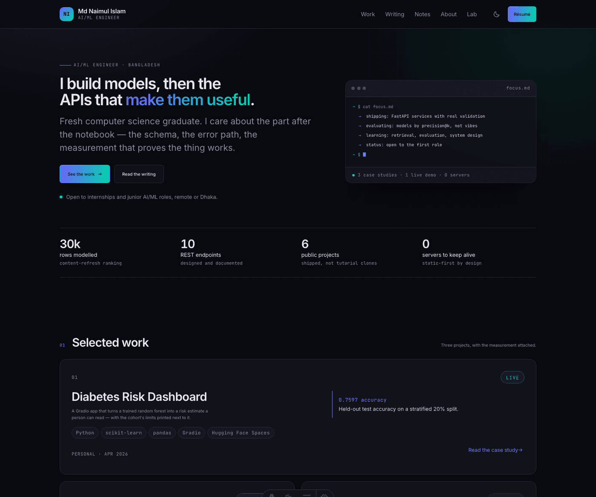

<div align="center">

# Md Naimul Islam — portfolio

**A production-grade personal site: Astro 5, typed content, zero servers, 3 KB of JavaScript.**

[](https://github.com/naimul3103/Portfolio/actions/workflows/ci.yml)
[](https://astro.build)
[](https://www.typescriptlang.org/)
[](LICENSE)

[Live site](https://naimul3103.pages.dev) · [Case studies](https://naimul3103.pages.dev/projects) · [Content model](docs/CONTENT-MODEL.md) · [Deployment](docs/DEPLOYMENT.md)

</div>



---

## What this is

A portfolio that is also a small engineering system. The content is markdown and
YAML in git; the site is statically rendered; the only runtime logic is a handful
of progressively-enhanced scripts. Every visible claim in a case study carries a
metric and a method, enforced by the schema — not by discipline.

Three properties define the build:
1. **Content is data, and data is validated.** Astro content collections with
   strict zod schemas. An unknown field, a missing measurement, or a cover image
   without alt text fails the build.
2. **The design is a token pipeline.** Colours, type scale, spacing, radii and
   motion live in `content/theme.yaml` and compile to CSS custom properties.
   Hard-coded colours fail CI (`scripts/check-no-hex.mjs`), and every palette is
   contrast-gated at WCAG AA (`scripts/check-contrast.mjs`).
3. **The site ships almost no JavaScript.** 3.2 KB gzip total across the build;
   search is a lazy 106 KB bundle that only loads on `/search`.

## Stack

| Layer      | Choice                                 | Why                                                             |
| ---------- | -------------------------------------- | --------------------------------------------------------------- |
| Framework  | Astro 5 (static output)                | HTML by default, islands only where earned                      |
| Styling    | Tailwind CSS 4 + CSS custom properties | Utilities for layout, tokens for identity                       |
| Content    | Markdown/MDX + YAML + zod              | Git is the database; schemas are the contract                   |
| Search     | Pagefind                               | Static index, client-side, zero infrastructure                  |
| CMS        | Sveltia (self-hosted bundle)           | Edit from a phone; every save is a draft PR                     |
| Hosting    | Cloudflare Pages                       | Free, per-PR previews, `_headers` support                       |
| Unit tests | Vitest                                 | Derivations, merge rules, résumé mapping                        |
| CI         | GitHub Actions                         | Content contract, contrast, types, tests, build, budgets, links |

## Quick start

```bash
# Node 22+ is required (see .nvmrc)
npm install
cp .env.example .env      # fill in PUBLIC_SITE_URL and your email
npm run dev               # http://localhost:4321
```

```bash
npm run build             # tokens → content gates → astro build → pagefind index
npm run preview           # serve the production build locally
```

## Scripts

| Script                  | What it does                                                        |
| ----------------------- | ------------------------------------------------------------------- |
| `npm run dev`           | Token compile + dev server                                          |
| `npm run build`         | Full production build, including search index                       |
| `npm run tokens`        | `content/theme.yaml` → `src/styles/tokens.css` (committed artifact) |
| `npm run check`         | `astro check` — types and templates                                 |
| `npm run check:content` | Content contract + contrast + no-hard-coded-colour gates            |
| `npm run test`          | Vitest unit suite                                                   |
| `npm run lint`          | Biome lint + format check                                           |
| `npm run og`            | Regenerate OG card and Apple touch icon from theme tokens           |
| `npm run links`         | Internal link + anchor check against `dist/`                        |
| `npm run audit:content` | Optional Python content audit (`requirements.txt`)                  |

## Project structure

```text
content/                  # the database
├── projects/*.md         # case studies (measured outcomes required)
├── blog/*.mdx            # long-form writing
├── notes/*.md            # short, dated notes
├── photos/*.md           # gallery entries
├── pages/*.yaml          # every visible page string
├── theme.yaml            # colours, type scale, radii, motion
├── navigation.yaml       # nav is content, validated against routes
├── site-config.yaml      # identity, availability, feature flags
├── resume.json           # JSON Resume — one source, two templates
└── data/projects.json    # automation-owned GitHub snapshot (read-only in CMS)

src/
├── content.config.ts     # collection schemas (strict)
├── schemas/config.ts     # singleton schemas
├── lib/                  # config loaders, merge rules, formatting, résumé mapper
├── components/           # layout, blog, projects, UI
├── layouts/BaseLayout.astro
├── pages/                # routes, RSS, 404
└── styles/               # tokens.css (generated) + global.css

scripts/                  # token pipeline, gates, OG, link check
public/                   # fonts-free static assets, headers, admin bundle
docs/                     # architecture, content model, deployment, CMS, quality
```

## Quality gates (all run in CI)

| Gate                 | Command              | Failure means                             |
| -------------------- | -------------------- | ----------------------------------------- |
| Content contract     | `check-content.mjs`  | missing field, unknown section, nav → 404 |
| Theme contrast       | `check-contrast.mjs` | a palette pair below WCAG AA              |
| No hard-coded colour | `check-no-hex.mjs`   | a hex value leaked into `src/`            |
| Types/templates      | `astro check`        | broken props or template expressions      |
| Unit tests           | `vitest run`         | a derivation or merge rule regressed      |
| Build                | `astro build`        | schema validation failed                  |
| JS budget            | `check-size.mjs`     | first-party JS exceeded 60 KB gzip        |
| Internal links       | `check-links.mjs`    | a link or anchor points at nothing        |

## Content workflow

```text
edit content/ (or use /admin)
   │
   ├─ local: npm run dev          → instant HMR
   └─ CMS:  save                  → draft PR → Pages preview → merge
                                        │
                                        └─ build → gates → deploy
```

Every project must supply `outcomes[].{claim, metric, method}` and at least 80
characters of `whatIdDoDifferently`. The schema rejects adjectives in the metric
field because there is nowhere to put them.

## Deployment

Cloudflare Pages, Git integration, zero configuration:
1. Create a Pages project → connect `naimul3103/Portfolio`.
2. Framework preset **Astro**, build command `npm run build`, output `dist`.
3. Add `PUBLIC_SITE_URL` (production origin) in the Pages environment.
4. Push to `main` → production. Open a PR → preview URL.

Full walkthrough, custom domain, CMS OAuth and rollback: [docs/DEPLOYMENT.md](docs/DEPLOYMENT.md).

## Status

| Area                                                     | State                                        |
| -------------------------------------------------------- | -------------------------------------------- |
| Design system, shell, dark/light mode                    | shipped                                      |
| Content engine (4 collections, 13 singletons)            | shipped                                      |
| Projects, blog, notes, about, now, gallery, contact, 404 | shipped                                      |
| Search (Pagefind), RSS, sitemap, JSON-LD, OG card        | shipped                                      |
| Résumé (Standard + Europass, print to PDF)               | shipped                                      |
| CMS config + self-hosted bundle                          | shipped, needs OAuth worker URL              |
| Contact/chat Worker                                      | specified, not deployed (Phase 6)            |
| giscus comments                                          | flag off until a Discussions category exists |
| Analytics, uptime monitor, Sentry                        | not wired                                    |

Known gaps and the exact next steps live in [docs/QUALITY.md](docs/QUALITY.md) and
[docs/CONTENT-TODO.md](docs/CONTENT-TODO.md).

## Documentation

| Document                                  | Read it for                                         |
| ----------------------------------------- | --------------------------------------------------- |
| [ARCHITECTURE.md](docs/ARCHITECTURE.md)   | how the pieces fit, and the decisions behind them   |
| [CONTENT-MODEL.md](docs/CONTENT-MODEL.md) | every field, every singleton, how to add content    |
| [DESIGN-SYSTEM.md](docs/DESIGN-SYSTEM.md) | tokens, type scale, components, accessibility rules |
| [DEPLOYMENT.md](docs/DEPLOYMENT.md)       | Pages, environment, domain, rollback                |
| [CMS.md](docs/CMS.md)                     | Sveltia, OAuth worker, R2 media, editorial workflow |
| [SECRETS.md](docs/SECRETS.md)             | what is secret, where it lives, how to rotate it    |
| [QUALITY.md](docs/QUALITY.md)             | gates, budgets, test matrix, known gaps             |
| [CHANGELOG.md](docs/CHANGELOG.md)         | build log, step by step                             |

## License

[MIT](LICENSE) — the code. The written content and résumé data are mine; please
do not republish them as your own.
